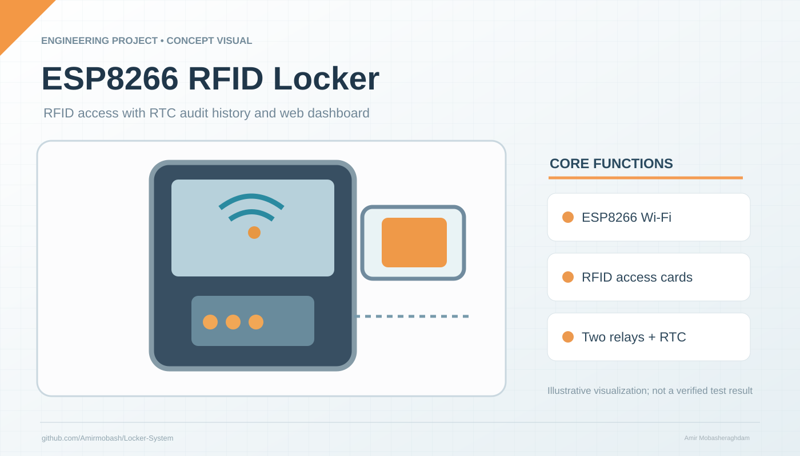

# ESP8266 RFID Locker Access System

Conceptual engineering illustration by Amir Mobasheraghdam; not a verified physical assembly.

## Overview

The `Locker-System.ino` sketch implements an **ESP8266-based RFID access control prototype** with a local web interface, a serial RFID reader, a DS1302 RTC, relay outputs for opening and closing, and LittleFS-based settings and logs.

## Source-defined interfaces

- Open relay: **D1**
- Close relay: **D4**
- RFID serial: **D5 (RX)** and **D2 (TX)**
- DS1302 RTC: **D6, D7 and D0**

## Security and electrical safety

**Prototype warning:** The committed firmware contains hard-coded access credentials and a default emergency code. Change all such values before connecting the unit to a network or controlling a real lock. The access system should be independently security-reviewed, and relay drivers must be appropriate for the actual mechanism. Do not treat this project as a certified physical access control product.

Author: Amir Mobasheraghdam.
